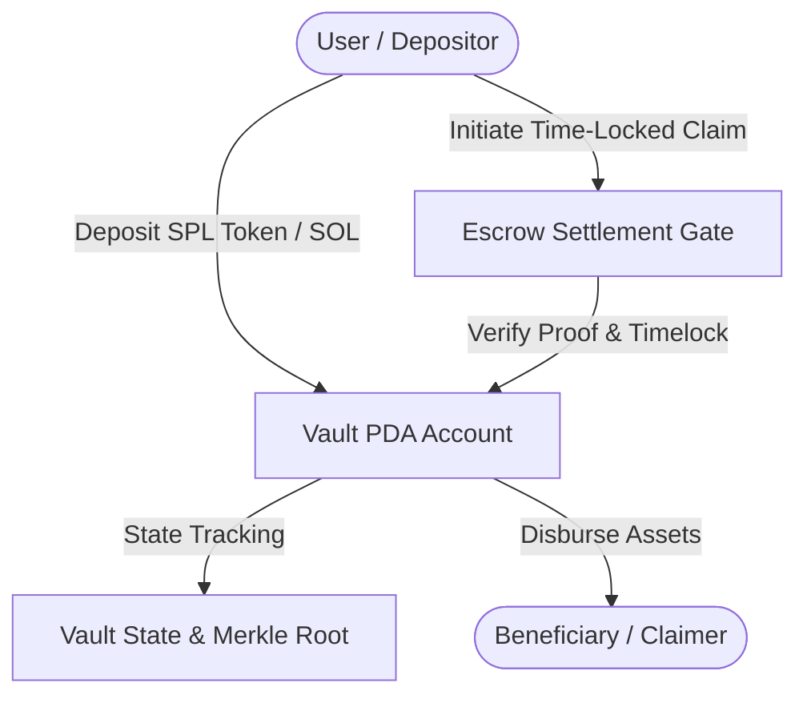

# Solana Anchor Vault Protocol

[](https://opensource.org/licenses/MIT)
[](https://solana.com)
[](https://www.rust-lang.org)

An audited, high-throughput non-custodial multi-token vault and programmatic escrow protocol deployed on the Solana blockchain. Engineered using the Anchor framework, featuring program-derived address (PDA) authority derivation, zero-copy deserialization, and strict re-entrancy prevention.

---

## 🏛 Architecture Overview



## ⚡ Key Features

- **Program-Derived Escrow (PDA)**: Automated escrow management with deterministic seeds ensuring multi-sig or timelocked custody without private key reliance.
- **SPL Token 2022 Compatibility**: Full support for native SOL, standard SPL Tokens, and Token-2022 extensions (transfer hooks, confidential transfers).
- **Time-Weighted Vesting**: Configurable linear and cliff vesting curves for programmatic team and community token distributions.
- **Re-entrancy Guard**: Cryptographic single-execution state locks preventing cross-CPI state manipulation.

## 📦 Directory Structure

```text
├── Anchor.toml
├── Cargo.toml
├── package.json
├── programs/
│   └── solana-anchor-vault/
│       ├── Cargo.toml
│       └── src/
│           └── lib.rs
└── tests/
    └── vault.ts
```

## 🛠 Local Development & Testing

```bash
# 1. Install Anchor CLI & Solana Toolsuite
avm install 0.30.0
avm use 0.30.0

# 2. Build smart contract binary
anchor build

# 3. Execute comprehensive integration test suite
anchor test
```

## 📄 License

Licensed under the MIT License.
